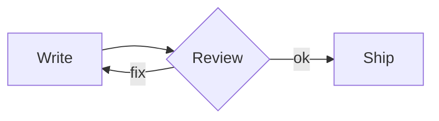

# mdr demo

Markdown in the terminal: **bold**, *italic*, ~~strike~~, `inline code`, [links](https://example.com) and footnotes[^1].

> [!NOTE]
> Press `?` in mdr to see all keys, and `t` for the table of contents.

## Lists and tables

- [x] Wrapped paragraphs and nested lists
- [x] Tables with alignment
- [ ] Your next document

| Feature  | Key | Works in |
|:---------|:---:|---------:|
| Search   | `/` |  any file |
| Fold     | `z` |  sections |
| Copy     | `y` | code blocks |

## Code and math

```rust
fn main() {
    let greeting = "hello";
    println!("{greeting}, terminal");
}
```

Pythagoras says $a^2 + b^2 = c^2$, and Gauss added the numbers up to $n$:

$$
\sum_{i=1}^{n} i = \frac{n(n+1)}{2}
$$

## Diagrams



```chart
type: bar
title: Lines of code
Rust: 6200
Tests: 1400
Docs: 400
```

[^1]: Footnotes link both ways: `Enter` jumps, `Backspace` comes back.
