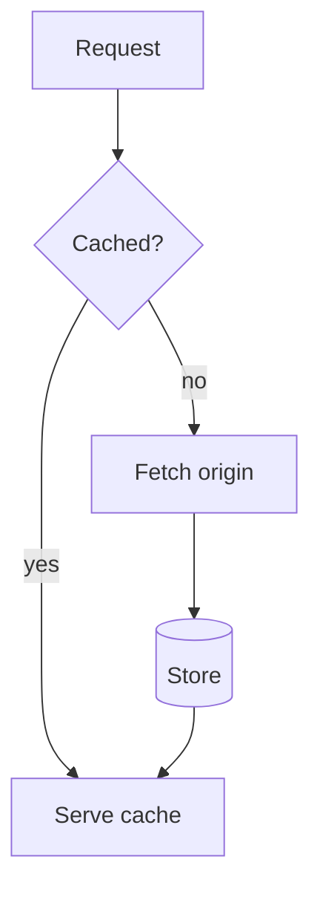
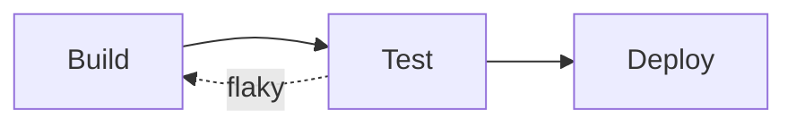
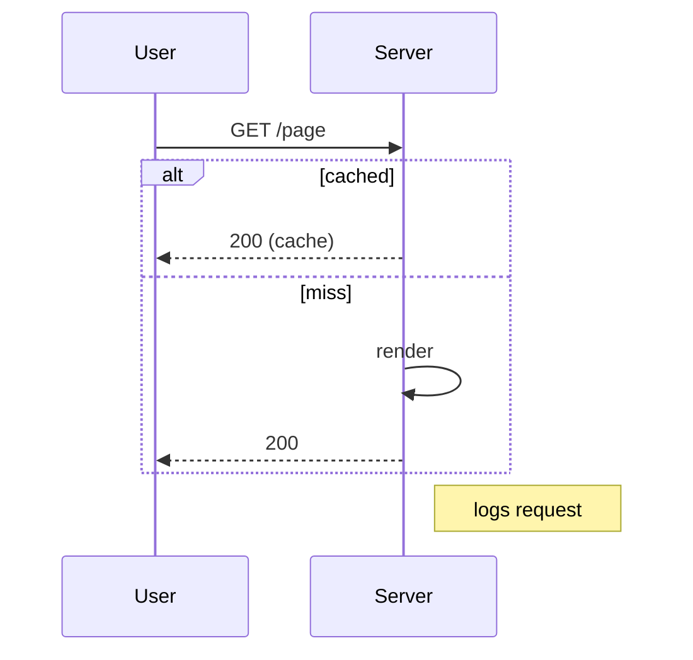
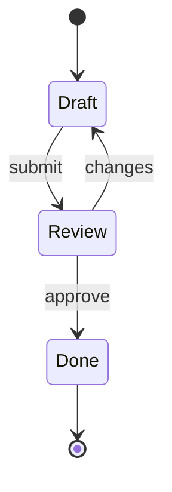
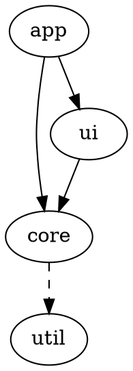
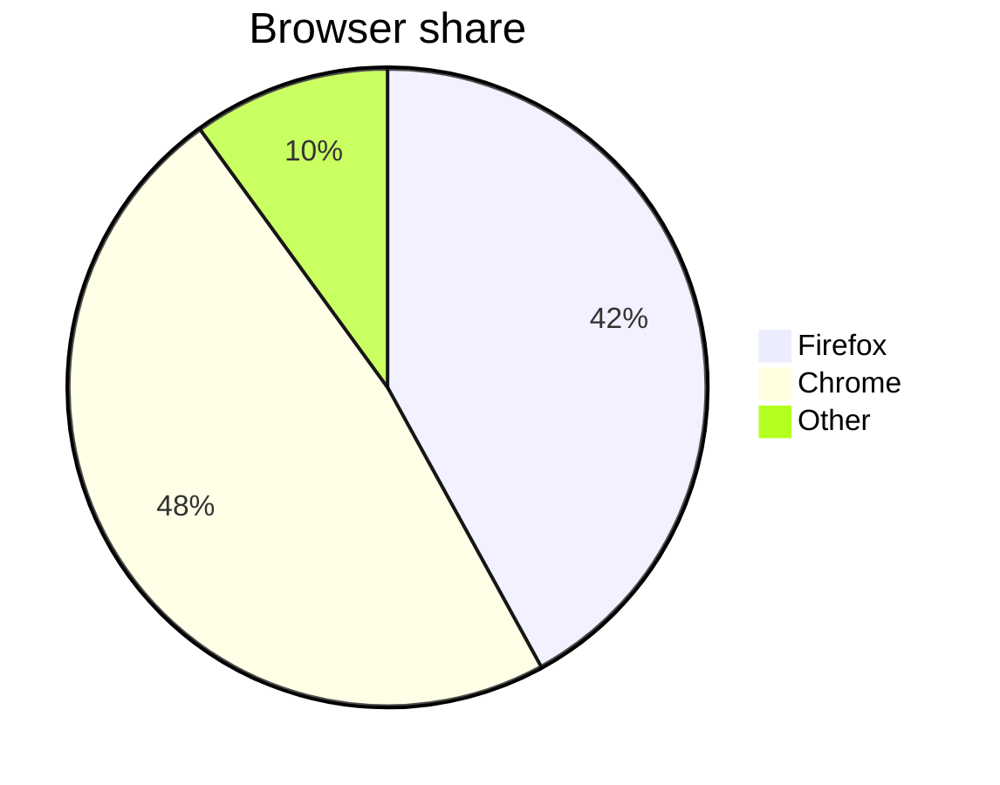
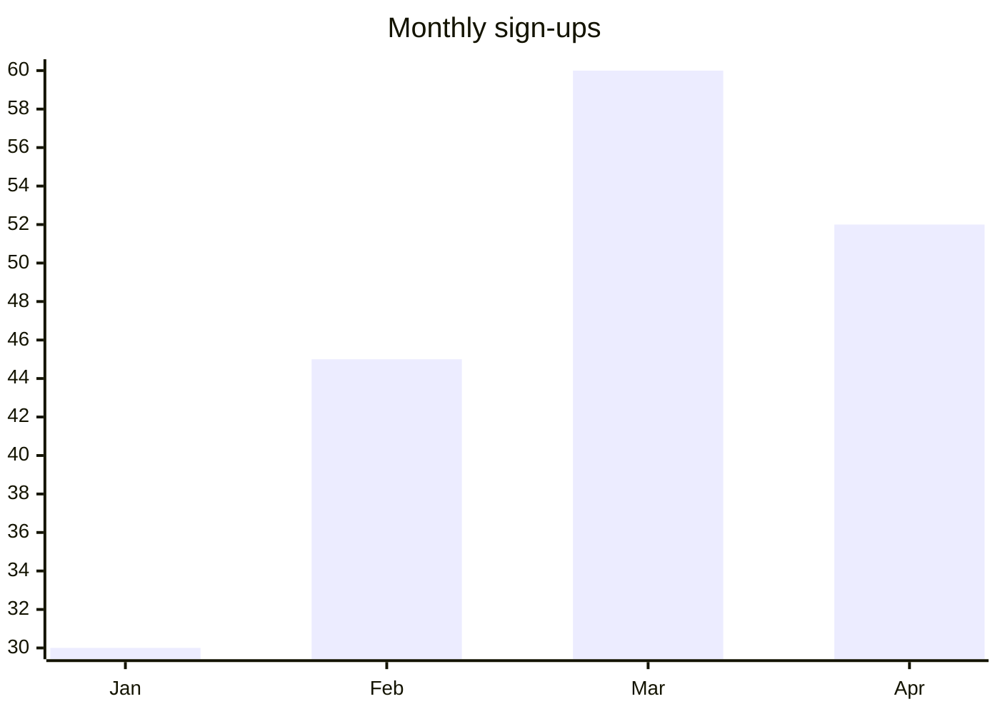

# Diagrams

## Mermaid flowchart



## Mermaid left to right



## Sequence



## State



## Graphviz



## Charts

```chart
title: Requests per day
Mon: 120
Tue: 340
Wed: 290
Thu: 410
Fri: 180
```

```chart
type: line
title: Latency (ms)
series: p50, p95
08:00: 20, 80
10:00: 25, 120
12:00: 40, 200
14:00: 30, 150
16:00: 22, 90
```





## Unsupported

```mermaid
gantt
    title Not drawn
```
